<!-- cartas:start — gerado por render_cards.py. Sem linhas em branco aqui dentro:
     o espaçamento já está nos SVGs, e cartas da mesma linha ficam coladas. -->

 
 
 
 
<picture><source media="(prefers-color-scheme: dark)" srcset="cartas/titulo-projetos-escuro.svg" /></picture> 
 
 

<!-- cartas:end -->

<a href="https://github.com/vittorbeckham?tab=repositories">repositórios</a> &nbsp;/&nbsp; <a href="https://github.com/vittorbeckham/projetos-ebac">notebooks de dados</a> &nbsp;/&nbsp; <a href="#vittor-beckham">voltar ao topo</a>

