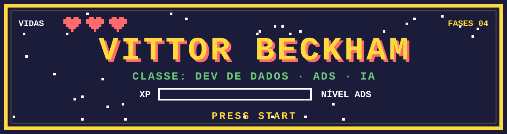
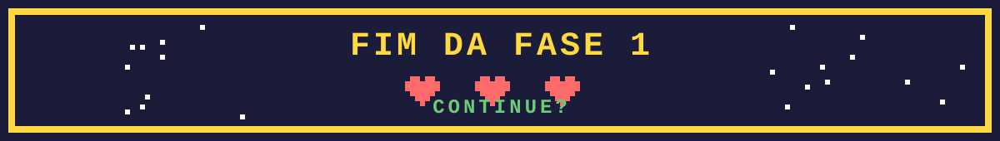

<<<<<<< HEAD

=======

>>>>>>> ef818023d11f393bdda8cf0b19299ae27b84ff77

  

**[Ficha](#-ficha-do-jogador) · [Inventário](#-inventário) · [Fases](#-fases-concluídas) · [Boss atual](#-boss-atual) · [Missões](#-próximas-missões)**

 

<<<<<<< HEAD
## 🎮 Ficha do jogador
=======

## 👨‍💻 Sobre mim
>>>>>>> ef818023d11f393bdda8cf0b19299ae27b84ff77

| Atributo | Valor |
| :--- | :--- |
| 🧑‍💻 **Jogador** | Vittor Beckham |
| ⚔️ **Classe** | Estudante de Análise e Desenvolvimento de Sistemas (ADS) |
| 📊 **Especialização** | Formação em Ciência de Dados |
| 🎯 **Próxima missão** | Pós-graduação em Engenharia de Inteligência Artificial |
| 🧪 **Em treino** | HTML, CSS, JavaScript e Python |
| 🤝 **Habilidades de apoio** | Prática, documentação e trabalho em equipe |

> 💡 *Exploro a conexão entre interfaces, código, dados e infraestrutura, aprendendo na prática. Aqui compartilho projetos acadêmicos e exercícios que unem programação, análise de dados e fundamentos de infraestrutura.*

<<<<<<< HEAD
## 🎒 Inventário
=======

## 🛠️ Minha base tecnológica
>>>>>>> ef818023d11f393bdda8cf0b19299ae27b84ff77

Itens equipados e ferramentas da jornada.

  

| Slot | O que venho praticando |
| :--- | :--- |
| 🌐 **Desenvolvimento web** | HTML e CSS na construção de interfaces; JavaScript em aprendizado |
| 🐍 **Programação** | Python, organização de funções e programação assíncrona |
| 📊 **Ciência de Dados** | NumPy, pandas, Matplotlib, Seaborn e scikit-learn em notebooks de estudo |
| 🐧 **Sistemas operacionais** | Linux, processos, sinais, prioridades e monitoramento de CPU e memória |
| 🔌 **Redes** | Cisco Packet Tracer, endereçamento IPv4, DHCP e testes de conectividade |

<<<<<<< HEAD
## 🚩 Fases concluídas
=======
## 🚀 Projetos que representam minha jornada
>>>>>>> ef818023d11f393bdda8cf0b19299ae27b84ff77

<table>
<tr>
<td width="50%" valign="top">

### 🟡 FASE 1 · Ciência de Dados

**Estudos EBAC**

Exercícios e projeto didático de **concessão de cartões de crédito**: exploração e preparação de dados, classificação com **Random Forest** e avaliação por acurácia e matriz de confusão. Inclui exercícios de arrays, operações vetorizadas e seleção de dados com NumPy.

**Contexto:** atividades orientadas de formação em Ciência de Dados.

[**▶ Jogar esta fase**](https://github.com/vittorbeckham/projetos-ebac)

</td>
<td width="50%" valign="top">

### 🔴 FASE 2 · Redes de Computadores

**Bragato Mix**

Projeto em equipe na **Faculdade Serra Dourada** (ADS) que representa a infraestrutura de um comércio real no Cisco Packet Tracer, com **DHCP**, topologia, documentação e evidências de testes de ping.

**Entrega:** simulação, relatório e evidências.

[**▶ Jogar esta fase**](https://github.com/vittorbeckham/projeto-lan-grupo-RVH-)

</td>
</tr>
<tr>
<td width="50%" valign="top">

### 🟢 FASE 3 · Sistemas Operacionais

**Processos Linux**

Trabalho em dupla na **Faculdade Serra Dourada** (ADS) sobre os processos do **Minecraft Java Edition no Ubuntu**: hierarquia (PID e PPID), uso de CPU e memória, prioridades e efeitos de sinais de controle.

**Entrega:** documentação, comandos e evidências em PDF.

[**▶ Jogar esta fase**](https://github.com/vittorbeckham/trabalho-linux-processos-)

</td>
<td width="50%" valign="top">

### 🔵 FASE 4 · Python e Automação

**Vittor.bot**

Projeto acadêmico da **Faculdade Serra Dourada** (ADS): bot para a plataforma **Highrise** com funções de interação e movimentação, integração com SDK, tarefas assíncronas e código organizado em módulos.

**Foco:** automação e programação orientada a eventos.

[**▶ Jogar esta fase**](https://github.com/vittorbeckham/Vittor.bot)

</td>
</tr>
</table>

<<<<<<< HEAD
## 👾 Boss atual
=======
## 🔭 Construindo agora
>>>>>>> ef818023d11f393bdda8cf0b19299ae27b84ff77

**VIGIA AI** é um projeto acadêmico em equipe na **Faculdade Serra Dourada** (ADS), voltado à proposta de **monitoramento inteligente**. A base atual reúne uma interface de acesso em HTML e CSS, backend em Python com Flask e infraestrutura com MySQL, Nginx e Docker Compose.

| Etapa do boss | Situação |
| :--- | :---: |
| Interface de acesso (HTML e CSS) | ✅ Concluída |
| Backend em Flask | ✅ Base pronta |
| Infraestrutura (MySQL, Nginx, Docker Compose) | ✅ Base pronta |
| Integração completa de autenticação | 🔜 Próxima etapa |
| Recursos de monitoramento e IA | 🔜 Próxima etapa |

<<<<<<< HEAD
=======

## 🎯 Onde quero chegar
>>>>>>> ef818023d11f393bdda8cf0b19299ae27b84ff77

## 🎯 Próximas missões

<<<<<<< HEAD
- [ ] 🎓 Cursar uma **pós-graduação em Engenharia de Inteligência Artificial**
- [ ] 🕹️ Aprofundar JavaScript e a integração entre interface e backend
- [ ] 📈 Evoluir meus estudos de análise e visualização de dados com Python
- [ ] 🔁 Melhorar a reprodutibilidade e as conclusões dos notebooks
- [ ] 📝 Continuar documentando os projetos e os resultados dos experimentos

## 🏆 Placar
=======

## 📈 Meu GitHub em números
>>>>>>> ef818023d11f393bdda8cf0b19299ae27b84ff77

 

[Voltar ao topo ↑](#vittor-beckham)

